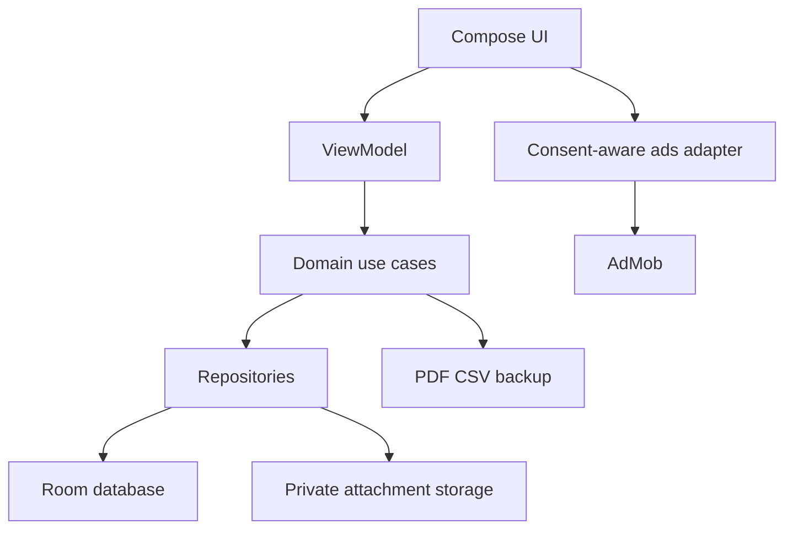

# 04 — Architecture and dependency evaluation
2026-11-18 | proposed native Android; exact versions subject to compatibility build

## Architecture decision
Kotlin, Jetpack Compose/Material 3, single Activity, unidirectional state and ViewModels, repository interfaces backed by Room as source of truth. Domain use cases for issuance, tax math, reports, backup. Android native APIs for PDFs, file sharing and storage. No server, account, cloud sync or AI. Ads isolated behind interface; no network prerequisite for startup. Start modular by feature packages, split Gradle modules when build or ownership justifies it. Proposed minSdk 26, targetSdk/compileSdk >=36; choose stable toolchain and verify Play policy.

## Candidate register
| Dependency/API | Role | Decision / verification |
|---|---|---|
| AGP, Gradle wrapper, Kotlin, JDK | Build | Pin supported matrix from official AGP release docs; verify reproducible CI; no dynamic versions |
| Compose BOM, Material3 | UI | Stable BOM; official compatibility guidance, add individual components |
| AndroidX Lifecycle ViewModel/runtime | Observable state | Flow, lifecycle-aware collection; current stable candidate 2.12.0 per Android latest updates |
| Navigation3 | Routing | Stable candidate 1.2.0; evaluate saved state and tablet back stack; prefer official recommendation |
| Room + KSP | SQLite and codegen | Room 2.8.5 candidate; check compiler/Kotlin, min SDK; migration testing; no destructive fallback |
| DataStore | Preferences | Stable release and migration verification |
| Kotlin coroutines | Async | Structured concurrency, cancellation, test dispatchers |
| Hilt or manual DI | Dependency injection | Prefer manual composition initially; Hilt only if complexity warrants |
| Android PdfDocument, FileProvider, SAF | PDF, share, import/export | Platform APIs reduce dependencies; implement pagination, Unicode and layout tests |
| Android Keystore, BiometricPrompt | App lock/key protection | Threat-model limitations; separate portable backup password; never claim app lock encrypts DB |
| AndroidX Test, JUnit, Compose UI test, Room testing | Quality | Unit, instrumented, migration, UI tests |
| Google Mobile Ads + UMP | Monetization | Consent, test IDs, privacy disclosure; confirm stable SDK compatibility and 16 KB support |
| WorkManager | Optional local reminder | Only if needed after validating notifications; no unnecessary scheduling |
## Governance
Version catalog and wrapper committed; verify dependency checksums, review transitive graph/SBOM, licences and CVEs; deny unreviewed advertising mediation, analytics, file conversion SDKs, dynamic code and unnecessary permissions. Run Gradle lint/tests/build and dependency report in CI; lock versions after test spike, keep update log. No binaries or signing credentials in Git.
## Sources
https://developer.android.com/topic/architecture/recommendations
https://developer.android.com/topic/architecture/data-layer/offline-first
https://developer.android.com/latest-updates
https://developer.android.com/develop/ui/compose/bom
https://developer.android.com/build/releases/gradle-plugin
https://developer.android.com/training/data-storage/room
https://developer.android.com/training/data-storage/room/migrating-db-versions
https://developer.android.com/guide/topics/providers/document-provider
https://developer.android.com/reference/android/graphics/pdf/PdfDocument
First four reviewed; remaining links are implementation reading candidates. Version snapshot is not a tested lockfile.
