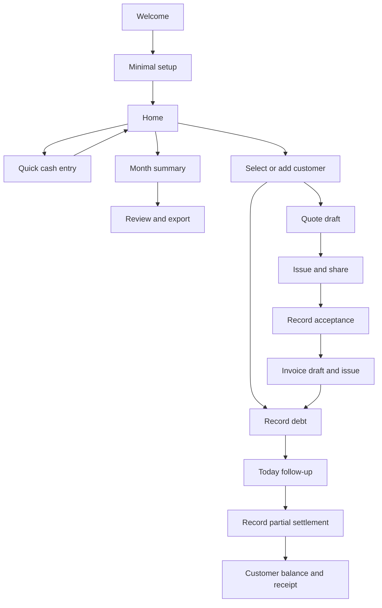

# 16 — MVP screen specification
2026-11-18 | Proposed wireframe contract, not implemented | M01–M11 in doc 14; B01–B13 in doc 13.

## Navigation and interaction rules
Home | Customers | Documents | Money | More. Today action queue accessible from Home. Contextual quick capture without losing draft; tablet list/detail and navigation rail. Android back preserves draft or asks before discard. 48dp controls, TalkBack labels, scalable text, no colour-only information. No ads on forms, customer details, notifications, legal, PDF or backup. Home and report banners only when allowed; offline/no-fill must never block content.

## Screen contract
| Screen and route | Trace | Layout and user actions | States and acceptance |
|---|---|---|---|
| S01 Welcome /welcome | M01 B01 B02 | Explain immediate benefit, Start, Restore, fictional demo, terms/privacy | Demo optional; no login/network; demo separate from live data |
| S02 Setup /setup | M01 B03 | Business display name, optional sector; defer formal details | Name only required; offline; continue to Home |
| S03 Home /home | M01 M08 B01 B11 | Period selector, recorded receipts/spend/net movement/debt; Money In, Money Out, Someone Owes Me; Today queue; backup status | Empty prompts first entry; totals drill down; no profit claim; optional banner |
| S04 Quick capture /money/new | M03 B03 | Amount keypad, date, type, method, category optional, customer/note optional; owner transfer separate | Positive amount and type; idempotent save; undo via reversal; no ad |
| S05 Customer list /customers | M02 B03 | Search name/phone, recent/outstanding filters, Add | Empty add CTA; archive linked customer, never delete historical records |
| S06 Customer editor /customers/new | M02 B03 | Required display name, optional phone/email, selected-contact picker, expandable formal fields | Duplicate warning use existing/continue; preserve originating draft; manual fallback |
| S07 Customer detail /customers/{id} | M02 M04 M06 B04 | Contact, outstanding, timeline, next action; add debt/payment/quote; statement preview | Settled/archived history; no false delivery status; reconcile totals |
| S08 Debt /debt/new | M04 B04 | Customer, amount, date, optional due date and note; link existing invoice if applicable | Reject duplicate links; no cash posted; customer required |
| S09 Settlement /payments/new | M04 B04 | Debt selector, outstanding, amount, date, method/reference, receipt preview | Partial reduces balance; excess rejected in MVP; reversal not deletion |
| S10 Documents /documents | M05 B08 | Quote/invoice/credit tabs; search/date/status; new draft | Empty CTA; linked debt visible; no duplicate documents |
| S11 Document editor /documents/edit/{id} | M05 B03 B08 | Customer selector/inline add, catalogue/recent/manual items, qty/price/discount/tax, terms/dates, preview | Draft autosave; inline validation; require tax profile at issue; no accidental issue |
| S12 PDF preview /documents/preview/{id} | M05 B08 | Paginated preview, parties, totals, tax, terms; draft watermark; issue or share | Long rows/Unicode tested; retry on export failure; issue once |
| S13 Document detail /documents/{id} | M04 M05 M06 B04 B08 | Status, linked debt/payment/credit, expiry/due; record acceptance, convert, share, correct | Immutable issued document; credit correction; unique conversion |
| S14 Today /actions | M06 B05 | Due/overdue/upcoming; open linked record, snooze, dismiss or prepare share | Permission denied still works; settled debts remove stale actions; no automatic messages |
| S15 Schedule editor /actions/schedule | M06 M07 B05 | Rule type, linked record, date/offset, cadence, time window, enable; preview next occurrence | Inexact timing disclosed; pause/cancel; recurring drafts only; P1 recurring scope pending |
| S16 Money ledger /money | M03 M04 M08 B09 | In/out/debt/transfer filters; dates, category, search; reverse/correct | Cash and debt separate; amounts reconcile; no double count |
| S17 Monthly pack /reports | M08 B01 B09 B11 | Period, receipts, paid expenses, transfers, outstanding, categories, completeness warning, narrative, PDF/CSV | No fabricated figures; empty state; revision when data changes; optional banner |
| S18 Catalogue /catalogue | M05 B03 | Search; item/unit/price/tax, edit/archive | Issued snapshots unchanged |
| S19 Business profile /settings/business | M05 B08 | Name, logo preview, contact/address, VAT status, serial settings, default terms | Changes affect future docs; non-vendor cannot charge VAT; formal issue validation |
| S20 Backup /settings/backup | M09 B06 | Last verified backup time, reminder, destination, password, backup/restore | Timestamp only on verified success; staged restore preview and rollback; wrong password explained |
| S21 More /more | M10 B10 | Catalogue, business profile, backup, settings, help, legal and privacy | Every destination reachable offline where content is local |
| S22 Settings /settings | M09 M10 M11 B06 B07 | Theme, accessibility, optional app lock, reminder preferences, currency display, data controls | No sensitive notification content by default; destructive confirmation |
| S23 Help /help | M10 B10 | Offline FAQ, workflow help, support address, version, export redacted diagnostics if user chooses | External contact requires network/user action; never attach records automatically |
| S24 Legal/privacy /legal | M10 B07 B12 | Terms, privacy, advertising choices, licences, policy versions | Offline bundled copies; separate ad consent; no requirement to consent to ads for core use |
| S25 Expense detail /money/expense/{id} | M03 M08 B09 | Supplier, amount, category, paid/unpaid, receipt attachment, linked ledger entry | Distinguish incurred vs paid; attachment removal explicit; no duplicated cash event |
| S26 Correction /documents/credit/{id} | M04 M05 B04 B08 | Original invoice, eligible line/amount, correction reason, preview, issue credit | Never exceed allowed amount or create unsupported refund; audit trail retained |

## Reference workflows

Invoice issuance links existing debt or creates it exactly once. If quote/invoice path already posts debt, F represents viewing that debt, not another manual entry.

## Validation and handover
Wireframes are the next design artifact: annotated layouts per screen, keyboard behavior, loading/empty/error states, tablet adaptations and clickable prototype. Test first entry, inline customer, partial settlement, due action and monthly report against closest competitor. No screen is approved or implemented yet. Screens S15 recurring features contingent on prioritization; final legal copy, exact navigation styling and backup implementation remain open. Each later screen change must cite M and B IDs and corresponding test evidence.
